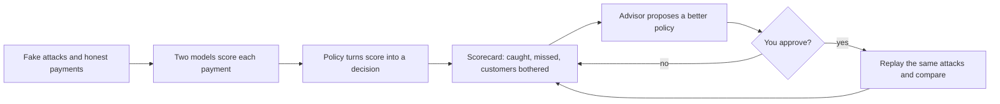

# Fraudverse

**A practice range for fraud detection.** Fraudverse invents fake attackers, lets them attack a
fake payment system, measures what gets through and which honest customers get wrongly stopped,
then suggests a better set of rules. A person approves or rejects every change.

> All data is **synthetic** (made up by the program). There is no real customer or card data, and
> every number you see describes the simulation, not real-world fraud.

---

## 1. The idea in plain words

Imagine a bank has an alarm system that decides whether each payment looks safe.

- If the alarm is **too relaxed**, thieves get away with money.
- If the alarm is **too jumpy**, honest customers get blocked while paying for dinner.

How do you know where the alarm stands? You hire a "fake thief" team to attack your own system
and count what happens. Fraudverse is that team, plus a scoreboard, plus an assistant that
suggests how to turn the alarm up or down.

## 2. How it works, step by step

1. **Make fake attacks.** The program creates a batch of payments. Most are normal. Some are
   fraud, made to look like real fraud patterns (a stolen account, a tiny test payment, a
   four-step takeover, and so on).
2. **Score every payment.** Two computer models look at each payment.
   One has learned what known fraud looks like. The other spots anything unusual.
   Their opinions are combined into one **risk score** from 0 to 1.
3. **Decide.** A **policy** (a set of thresholds, like "above 0.75 means stop it") turns the
   score into one of four decisions: `ALLOW`, `MONITOR`, `VERIFY` (ask the customer to
   confirm), or `BLOCK`.
4. **Keep score.** The **scorecard** counts how many attacks were caught, how much fraud money
   got through, and how many honest customers were bothered.
5. **Suggest and approve.** The **advisor** tries many policy settings, shows what each would
   have changed, and proposes one. **You decide.** If you approve, the same attacks are replayed
   so you can see the real effect.



## 3. What you need installed

| Tool | Version | Check it with |
|---|---|---|
| Python | **3.12** (tested). Newer versions such as 3.15 do not work yet, see Troubleshooting | `py --version` or `python --version` |
| Node.js | 22 or newer (tested on 25) | `node --version` |
| pnpm | any recent | `pnpm --version` (install with `npm install -g pnpm`) |
| Git | any | `git --version` |

You do **not** need an AI service or an API key. Everything runs on your computer.

## 4. Run it (Windows PowerShell)

You will use **two terminal windows**: one for the backend (the brain) and one for the frontend
(the website you look at).

**Step 1. Get the code.**
```powershell
git clone https://github.com/badaveswapnil336-ops/Fraudverse.git
cd Fraudverse
```

**Step 2. Set up Python (once).**
```powershell
py -3.12 -m venv .venv
.\.venv\Scripts\python.exe -m pip install -r requirements.txt -r ml\requirements.txt
copy .env.example .env
```
The `.env` file holds settings. The defaults work as they are. Leave it alone.

**Step 3. Start the backend (terminal 1). Leave it running.**
```powershell
.\.venv\Scripts\python.exe -m uvicorn backend.app.main:app --host 127.0.0.1 --port 8000
```
Open <http://127.0.0.1:8000>. You should see `{"message":"Fraudverse backend is running"}`.
Interactive API docs are at <http://127.0.0.1:8000/docs>.

**Step 4. Start the website (terminal 2). Leave it running.**
```powershell
cd frontend
pnpm install
pnpm dev
```
Open <http://127.0.0.1:3000>.

**Mac or Linux:** use `python3.12 -m venv .venv` and `.venv/bin/python` instead of
`py -3.12 ...` and `.\.venv\Scripts\python.exe`, and `cp` instead of `copy`.

To stop either one, click its terminal and press `Ctrl+C`.

## 5. Your first 5 minutes

1. On the **Overview** page click **Demo mode**, then **Start demo**. In a few seconds you see
   the **baseline**: three fixed attack runs under the starting policy.
2. Click **Step 2: ask the advisor**. It proposes new thresholds and shows why.
3. Click **Approve all changes**. The same attacks run again under the new policy and a
   **before / after** table appears.
4. Click **Reset demo** to put the policy back to the start.

The demo uses fixed random "seeds", so it gives the **same numbers every time**. These are the
numbers it gives on a standard install:

| | Before | After |
|---|---|---|
| Attack campaigns caught | 17 of 17 | 17 of 17 |
| Fraud value let through | Rs 67,667 | Rs 67,667 |
| Honest payments blocked | 39 | 0 |
| Honest payments bothered (blocked or asked to verify) | 53 of 1,096 (4.8%) | 39 of 1,096 (3.6%) |

Read it honestly: the demo does **not** catch more fraud. It stops blocking honest customers
and bothers 14 fewer of them, without losing any fraud on these runs. Real data could behave
very differently.

## 6. The pages

| Page | What it is for |
|---|---|
| **Overview** | Start here. Demo mode, headline numbers, charts, the attack lab and cases. |
| **Live Transactions** | A live feed of what the system is doing, and every scored payment with its decision. |
| **Attack Lab** | Launch your own attack: pick a type, a size, and optionally a seasonal month. |
| **Simulations** | All past runs, and the "what should the attacker try next" feedback loop. |
| **Policy Advisor** | The approval screen: launch runs, ask for a proposal, approve or reject, see the history. |
| **Risk Engine** | How scores are combined and the active thresholds. |
| **Fraud Cases** | Every payment that was challenged or blocked, with a plain-language reason. |
| **AI Investigator** | Pick one case and see why it was flagged next to the real payment details. |
| **Models** | Precision, recall and the confusion matrix. |
| **Reports** | The full scorecard for any run, with downloads (JSON and CSV). |
| **Settings** | Read-only view of the connection and the active policy. |

## 7. Words you will see

| Word | Meaning |
|---|---|
| **Campaign** | A burst of fraud payments from one customer over a short time. |
| **Scorecard** | The results table for one run. |
| **Policy** | The thresholds that turn a risk score into ALLOW, MONITOR, VERIFY or BLOCK. |
| **Threshold** | A cut-off. "Verify above 0.55" means scores over 0.55 trigger a check. |
| **VERIFY / BLOCK** | VERIFY asks the customer to confirm. BLOCK stops the payment. |
| **Friction** | Honest payments that were blocked or challenged. Lower is better for customers. |
| **Let through** | Fraud money that was allowed. Lower is better for the bank. |
| **Seed** | A number that makes "random" data repeat exactly. Same seed, same data. |
| **Hard negative** | An unusual but honest payment (travel, a new payee) used to test false alarms. |
| **Advisor** | The part that tests policy settings and proposes changes. It never applies anything itself. |

## 8. The six attack types

| Attack | In one line |
|---|---|
| Account takeover | Someone logs in as the customer and pays out. |
| AI social engineering | The customer is talked into approving a payment to a new payee. |
| Synthetic identity | A made-up customer builds a history, then cashes out. |
| Card testing | Many tiny payments to check whether stolen card details work. |
| Velocity burst | A fast run of normal-sized payments to new payees, like a quick cash-out. |
| Multi-step takeover | Account change, new payee, small test payment, then a large transfer. |

Each is matched to a public fraud description, with the sources and how far the match goes, in
[docs/fraud-typologies.md](docs/fraud-typologies.md). Tick **Seasonal month** in the Attack Lab
for a 30-day month with weekend, month-end salary and festival-week behaviour.

## 9. Run the tests

```powershell
# backend (from the project folder)
.\.venv\Scripts\python.exe -m pip install pytest
$env:PYTHONPATH="."
.\.venv\Scripts\python.exe -m pytest tests -q

# frontend (from the frontend folder)
npx tsx --test lib/demo.test.ts lib/advisorUtils.test.ts lib/apiErrors.test.ts
```
One backend test is **meant** to fail ("expected failure"). It records a real weakness: the
shipped models wrongly block many festival-week payments. See below.

## 10. What is where

```
Fraudverse/
├── backend/
│   └── app/
│       ├── main.py          the web server
│       ├── routers/         the web addresses (endpoints)
│       ├── simulator/       makes fake customers, payments and attacks
│       ├── scorecard.py     the results table
│       ├── advisor.py       tries policies and writes proposals
│       └── db/              saves runs to a local database file
├── ml/
│   ├── models/              the two scoring models (trained files are included)
│   ├── risk_engine/         combines scores, applies the policy, re-scores past runs
│   └── scenario_generator/  attack settings (built-in rules, optional AI)
├── frontend/                the website (Next.js): app/ = pages, components/, lib/
├── shared/                  the data formats everyone agrees on
├── tests/                   automatic checks
└── docs/                    demo script, judges' Q&A, sources, limits
```

## 11. The web addresses (API)

Open <http://127.0.0.1:8000/docs> for the full interactive list. The main ones:

| Method | Address | Purpose |
|---|---|---|
| POST | `/simulate/launch` | Make an attack run and score it |
| GET | `/scorecard/{run_id}` | The results table for a run |
| GET | `/policy` | The active policy |
| POST | `/advisor/suggest` | Ask for a proposal |
| POST | `/advisor/proposals/{id}/approve` | Approve (all or some changes) |
| POST | `/advisor/proposals/{id}/reject` | Reject |
| POST | `/policy/reset` | Back to the starting policy |
| GET | `/cases`, `/transactions` | Flagged payments, all scored payments |

## 12. Honest limits

- Everything is **synthetic**. The numbers do not predict real fraud.
- The two models were trained on data from the same kind of simulator, so the results are
  "in-distribution" and flattering.
- The shipped models are **weak on seasonal peaks**. On seeded runs they blocked about 78% of
  festival-week and 35% of salary-day honest payments. Retraining on seasonal data is the fix.
- The advisor's cost figures come from **assumed** costs, not real money.
- Each payment is scored on its own, so the models do not see a sequence of steps.
- The sizes and rates used for attacks and seasons are assumptions, not measurements.

Full list: [docs/known-limitations.md](docs/known-limitations.md).

## 13. Troubleshooting

| Problem | Fix |
|---|---|
| `python` is "not found" | Use `py -3.12` (Windows) or install Python 3.12. |
| `pip install` fails building `pydantic_core` | You are on a Python version that is too new (3.15 fails). Use 3.12 for the virtual environment. |
| `pnpm` is "not recognized" | `npm install -g pnpm`, then open a new terminal. |
| PowerShell blocks a script | `Set-ExecutionPolicy -Scope CurrentUser RemoteSigned` |
| Yellow "Cannot reach the Fraudverse backend" banner | The backend (terminal 1) is not running. Start it, then click **Retry**. |
| Port 8000 or 3000 already in use | Close the other program, or stop the old server with `Ctrl+C`. |
| Demo numbers differ from the table | Someone changed the seeds, models or scenarios. Trust the screen. |
| Backend change has no effect | Restart the backend. It does not reload by itself. |

## 14. More documentation

- [docs/demo-script.md](docs/demo-script.md): a 3-minute click-by-click demo.
- [docs/judges-qa.md](docs/judges-qa.md): one-page answers to likely questions.
- [docs/advanced-features.md](docs/advanced-features.md): the scorecard, advisor and approval loop in detail.
- [docs/fraud-typologies.md](docs/fraud-typologies.md): attack types and their public sources.
- [docs/known-limitations.md](docs/known-limitations.md): what it does not do.
- [shared/CONTRACTS.md](shared/CONTRACTS.md): the data formats between parts.
- [DEPLOYMENT.md](DEPLOYMENT.md): putting it on the internet (optional).
